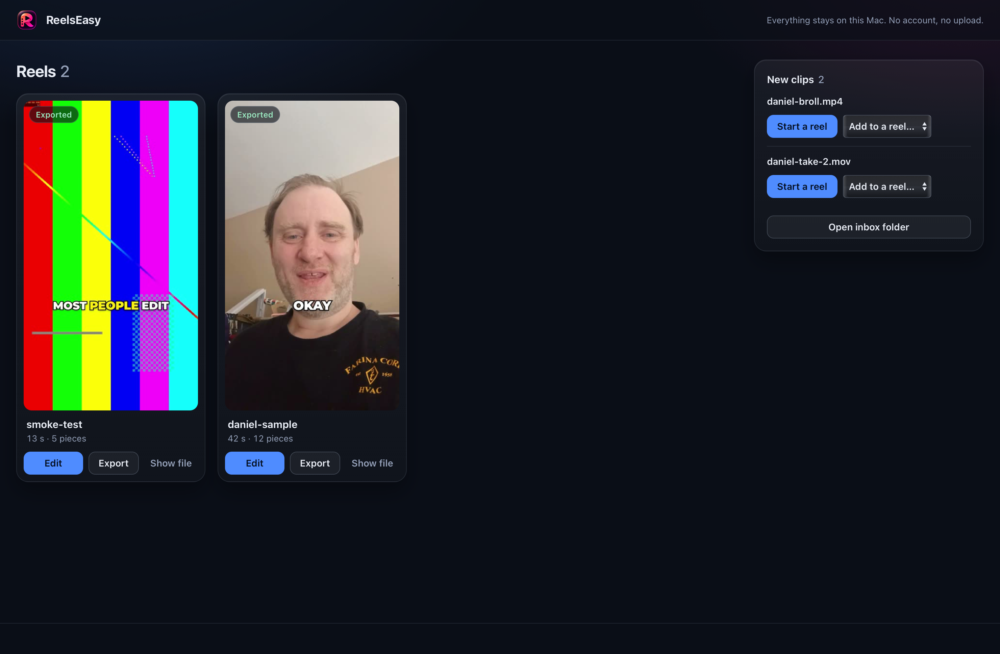
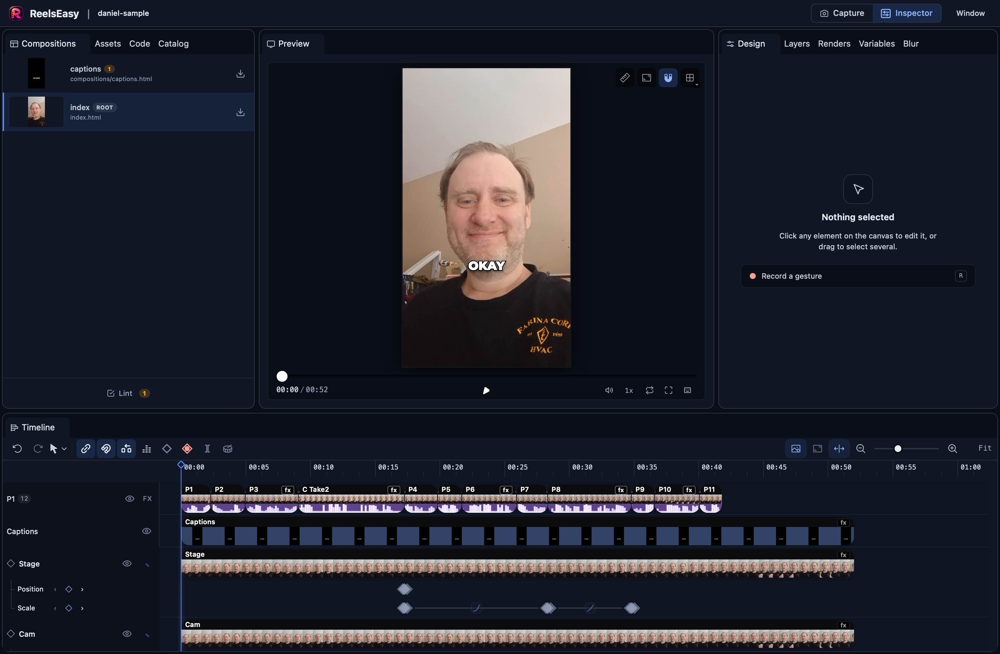

# ReelsEasy

A free Mac app that turns a vertical phone clip into a finished reel. Everything runs on your Mac: no account, no upload, no paid service.





It cuts pauses, adds word-by-word captions, zooms, emojis, sound effects, transitions, picture effects such as glitch and VHS, and a colour grade. You can bring in other clips, and it levels the sound. The export is a 1080x1920 file you upload to Instagram or TikTok yourself.

You can edit a reel two ways, and they share one project:

- **By hand**, on a timeline: drag pieces, trim, split, move sounds and effects, retype captions.
- **By telling a coding agent** such as Claude Code what you want. Nothing you moved by hand is overwritten.

## Status: developer preview

There is no download that just opens yet. You build the app from this repository, which takes about five minutes. It has been run on one Apple Silicon Mac. `CLAUDE.md` lists what has been tested and what has not; `docs/architecture.md` is the plan for a signed download.

## Set it up

You need an Apple Silicon Mac with macOS 13 or later, [Homebrew](https://brew.sh) and the Xcode command line tools (`xcode-select --install`).

```bash
brew install bun ffmpeg
```

```bash
git clone https://github.com/Alexfrompixel/reelseasy.git
```

```bash
cd reelseasy && bun install
```

`bun install` also makes fourteen of the sound effects on your Mac (see "Sounds" below).

Then the speech model, about 640 MB, downloaded once:

```bash
node_modules/.bin/hyperframes models install parakeet
```

ReelsEasy starts the video engine (HyperFrames) with its usage reporting switched off. To switch it off for commands you type yourself as well:

```bash
node_modules/.bin/hyperframes telemetry disable
```

Build and open the app:

```bash
bash app/build.sh
```

```bash
open ReelsEasy.app
```

The app remembers where this folder is, so run `bash app/build.sh` again if you move it.

## Use the app

- **Start a reel:** drop a clip on the Dock icon, or put it in `inbox/` and press "Start a reel". It is transcribed and cut, and the editor opens.
- **Edit:** drag pieces to reorder them, drag their edges to trim, split at the playhead, move sounds, change the grade. Captions follow the pieces by themselves.
- **Add another clip:** put it in `inbox/` and choose a reel under "Add to a reel…". It lands at the end of that reel as a piece of its own.
- **Effects and transitions:** each effect is a short clip on its own lane. Drag it, trim it or delete it. Transitions show as keyframes on the "Stage" and "Veil" rows.
- **Export:** go back with "All Reels" and press "Export". The file lands in `exports/`.

## Use it with a coding agent

The first time you open the app it asks whether you edit with Claude Code or with Codex, the coding agent from the makers of ChatGPT. Pick one and it opens in Terminal, in this folder, ready to take instructions. Later, the "Ask Claude" or "Ask Codex" button in the app does the same. You can also open the agent in this folder yourself: Claude Code reads `CLAUDE.md`, Codex reads `AGENTS.md`. So far only Claude Code has been tried.

Then say what you want:

> Edit inbox/IMG_1234.MOV into a reel.

> In img-1234, zoom in on "five minutes" and add a whoosh.

> Add a glitch transition before "but here is the thing", and make "it broke" look like VHS.

> Bring inbox/screen.mov into img-1234 and show it in a corner while I talk about the dashboard.

Transitions: glitch, whip, zoom, flash, blur, dip to black, shake. Effects: glitch, colour split, VHS, CRT, film, pixelate, blur, glow, black and white, halftone, ASCII, shake, flash.

`CLAUDE.md` is the agent's manual: every command, every field of a reel's `edit.json`, and the rules that are easy to break.

## From a terminal

```bash
bun scripts/reel.ts ingest inbox/IMG_1234.MOV
```

```bash
bun scripts/reel.ts build img-1234
```

```bash
bun scripts/reel.ts render img-1234
```

`import` brings a second clip into a reel, `list` shows your reels, `serve` runs the app's pages without the app.

## Folders

- `inbox/` your raw clips (never in git)
- `reels/<name>/` one working folder per reel (never in git)
- `exports/` finished videos (never in git)
- `sfx/` the sound pack; open `sfx/preview.html` to listen
- `app/` the Mac app's source
- `scripts/` the pipeline and its tests (`bun test`)
- `brand/` logo and icons
- `site/` the website at reelseasy.com, an Astro project (`cd site && bun install && bun run dev`)
- `docs/` the plan

## Sounds

The pack has 19 sounds. Five are CC0 and are in this repository. The other fourteen are under the Pixabay Content License, which does not allow handing the files out on their own, so they are not here. HyperFrames ships the originals in its own package, and `bun scripts/reel.ts sounds` (run for you by `bun install`) cuts them on your Mac. Details are in `sfx/CREDITS.md`.

## Credits and licence

ReelsEasy's own code is under the [Apache License 2.0](LICENSE). The name ReelsEasy and the logo are not covered by that licence; see `NOTICE`.

- The timeline editor and the renderer are [HyperFrames](https://github.com/heygen-com/hyperframes) by HeyGen, Apache-2.0. Inside the app it is shown in ReelsEasy's colours, with HeyGen's own product buttons hidden.
- Speech recognition is NVIDIA's Parakeet model, run on your Mac.
- The screenshots above show a frame from "Daniel speaking English" by Wikitongues (Wikimedia Commons), CC BY-SA 4.0. The two screenshot files are under the same licence.

Contributions are welcome: see `CONTRIBUTING.md`.
